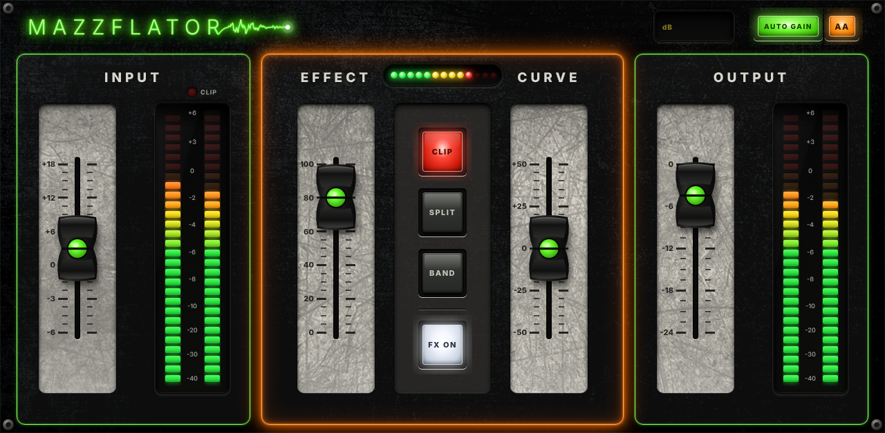

# MAZZFLATOR — loudness & saturation plugin for Akai MPC (MPC OS 3.10.1+)



**FR** — MAZZFLATOR est un effet de densité et de saturation pour les MPC autonomes, inspiré du fonctionnement de l'Oxford Inflator de Sonnox. Il dérive de [JS Inflator](https://github.com/Kiriki-liszt/JS_Inflator) de Kiriki-liszt. Depuis la **v2.0**, il est construit avec le [SDK officiel Akai / inMusic](https://github.com/inmusic-software/mpc-plugin-builder-sdk) et s'installe sur le firmware officiel, sans modification de la MPC. Gratuit et libre, sous licence GPL v3.

**EN** — MAZZFLATOR is a loudness / density / saturation effect for standalone Akai MPCs, modelled on the behaviour of the Sonnox Oxford Inflator. Derived from Kiriki-liszt's JS Inflator. Since **v2.0** it is built with the [official Akai / inMusic plugin SDK](https://github.com/inmusic-software/mpc-plugin-builder-sdk) and runs on stock firmware. Free software, GPL v3.

## What's new in 2.0 / Nouveautés de la 2.0
- **Same sound as 1.0** (checked sample by sample against the 1.0 engine, 13 test cases, within 16-bit rounding). / **Même son que la 1.0**.
- Runs on the **official MPC OS 3.10.1 or later**: no modified firmware needed. / Fonctionne sur le **firmware officiel**.
- **32-bit and 64-bit** MPCs, including MPC Live III and MPC XL. / MPC **32 et 64 bits**.
- New install method: a `VST2 Plugins` folder on any drive. / Nouvelle installation : dossier `VST2 Plugins`.
- ⚠️ **Projects saved with 1.0 do not recall their MAZZFLATOR settings** (the saved-state format changed). Note your settings before updating. / Les projets faits avec la 1.0 ne retrouvent pas les réglages du MAZZFLATOR.

## Réglages / Controls
- **INPUT** -6 → +18 dB (0 dB at 40 % of travel) · **EFFECT** 0–100 % · **CURVE** -50 → +50 · **OUTPUT** 0 → -24 dB
- **CLIP 0dB** (on by default), **SPLIT** (3 bands), **BAND** (mid band only), **FX ON**
- **AUTO GAIN** (matches output loudness to input), **AA** (2× oversampling, 23 samples latency)
- Input / output meters (Sonnox-style scale, red overdrive zone up to +6 dB), input **CLIP** light (2 s hold), live effect meter with a glowing frame that follows the dose.

Details: [docs/FICHE_TECHNIQUE.md](docs/FICHE_TECHNIQUE.md) (FR).

## Installation
1. On the MPC: **MPC OS 3.10.1 or later** (Preferences → Info), then Preferences → **Enhancements (Beta)** → turn on **Enable Enhancements** and **External Plugin Support**.
2. Download `MAZZFLATOR-v2.0-MPC.zip` from the **Releases** page and unzip it.
3. Copy the folder `Mazztock - VST - MAZZFLATOR` into a folder named **`VST2 Plugins`** at the root of an MPC drive (internal storage, SD card, USB or SATA drive), replacing any older copy.
4. Restart the MPC. MAZZFLATOR is listed under **External Plugins** (Mazztock).

Coming from 1.0 (modified firmware)? The old copy lived in `Synths/`: the official firmware ignores it, you can delete it.

## Compiler / Build
Needs the [official MPC plugin SDK](https://github.com/inmusic-software/mpc-plugin-builder-sdk) and Python 3.9+ (the SDK downloads its Zig compiler; no Docker).
1. Copy `source/` to `<sdk>/plugins/MAZZFLATOR/`.
2. From the SDK folder:
```
python3 tools/build.py plugins/MAZZFLATOR
.sdk-tools/host_sim plugins/MAZZFLATOR/build/native/mazzflator.dylib test
plugins/MAZZFLATOR/tests/run_compare.sh      # compares with the 1.0 engine (macOS / Linux, clang++)
```
The plugin folder is written to `plugins/MAZZFLATOR/build/Mazztock - VST - MAZZFLATOR/`.

Sources: engine `source/src/MazzflatorEngine.*` (shared with the desktop version), MPC glue `source/src/MAZZFLATOR.cpp`, skin `source/skins/`, tests `source/tests/`. The 1.0 sources (mpc-vst-plugins SDK) are in the git history and the v1.0 release.

## Crédits / Credits
- DSP based on **JS Inflator** by Kiriki-liszt (GPL v3), itself a recreation of the Sonnox Oxford Inflator.
- MPC plugin SDK: **mpc-plugin-builder-sdk** by Akai Professional / inMusic (MIT).
- Version 1.0 was built with **mpc-vst-plugins** by sd88me (MIT); its engine interface (`source/tests/reference/engine.h`, MIT) is kept for the comparison test.
- MAZZFLATOR, skin 2026 and changes (two-slope input, soft ceiling above 0 dBFS, auto gain, AA, BAND, metering): Mazztock, made with Claude (Anthropic).
- Sonnox and Oxford Inflator are trademarks of Sonnox Ltd. This project is not affiliated with Sonnox, nor endorsed by Akai Professional or inMusic.

## Licence
GPL v3 — see [LICENSE](LICENSE). Copyright © 2026 Mazztock.
